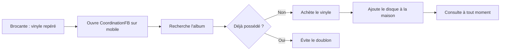
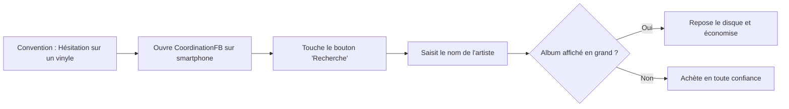

# 🎵 Persona — CoordinationFB

> **Objectif du projet :** permettre aux collectionneurs de gérer leurs vinyles au même endroit, simplement et efficacement.

---

## Sommaire

1. [Profil utilisateur](#1-profil-utilisateur)
2. [Présentation](#2-présentation)
3. [Objectifs](#3-objectifs)
4. [Besoins](#4-besoins)
5. [Frustrations](#5-frustrations)
6. [Habitudes d'utilisation](#6-habitudes-dutilisation)
7. [Motivations](#7-motivations)
8. [Citation représentative](#8-citation-représentative)
9. [Scénario d'utilisation](#9-scénario-dutilisation)
10. [Fonctionnalités prioritaires](#10-fonctionnalités-prioritaires)
11. [Synthèse](#11-synthèse)

---

## 1. Profil utilisateur

| Information | Détail |
|---|---|
| **Nom** | Thomas Morel |
| **Âge** | 32 ans |
| **Profession** | Technicien informatique |
| **Localisation** | Strasbourg, France |
| **Niveau en informatique** | Bon |
| **Type d'utilisateur** | Collectionneur de vinyles |
| **Taille de la collection** | Plus de 200 vinyles |

---

## 2. Présentation

Thomas est un passionné de musique qui collectionne des vinyles depuis plusieurs années. Sa collection est principalement composée de **rock**, de **jazz** et de **musique électronique**.

Il achète régulièrement de nouveaux disques dans des disquaires, des brocantes et sur Internet. Avec le temps, il devient difficile de se souvenir de tous les albums qu'il possède et de retrouver rapidement les informations associées.

Il souhaite donc utiliser **CoordinationFB** pour centraliser et gérer l'ensemble de sa collection.

---

## 3. Objectifs

- [x] Centraliser sa collection de vinyles dans une seule application
- [x] Ajouter facilement de nouveaux disques
- [x] Consulter les informations de chaque album
- [x] Retrouver rapidement un vinyle grâce à la recherche
- [x] Organiser sa collection selon ses préférences
- [x] Éviter d'acheter plusieurs fois le même disque
- [x] Suivre l'évolution de sa collection

---

## 4. Besoins

- Une **interface simple, claire et intuitive**
- Un **formulaire** pour ajouter un vinyle
- Une **liste** permettant de visualiser toute sa collection
- Un **système de recherche rapide**
- La possibilité de **consulter et de modifier** les informations d'un vinyle
- Une interface **adaptée aux ordinateurs et aux appareils mobiles** (responsive)

---

## 5. Frustrations

| Frustration | Impact |
|---|---|
| Il oublie parfois quels albums il possède déjà | Risque de doublons à l'achat |
| Ses informations sont dispersées entre plusieurs supports | Manque de vue d'ensemble |
| Il perd du temps à rechercher un disque précis | Perte de temps |
| Certaines applications de gestion sont trop complexes | Abandon de l'outil |
| La saisie répétitive des informations peut entraîner des erreurs | Données peu fiables |

---

## 6. Habitudes d'utilisation

- 📅 Il consulte sa collection **plusieurs fois par semaine**
- ➕ Il ajoute ses **nouveaux achats** à son inventaire
- 🔍 Il **vérifie sa collection avant d'acheter** un album
- 💻 Il utilise principalement son **ordinateur à domicile**
- 📱 Il consulte également sa collection sur son **téléphone** lorsqu'il se rend dans un disquaire ou une brocante

---

## 7. Motivations

- Préserver et valoriser sa collection personnelle
- Garder une vue d'ensemble de ses disques
- Retrouver facilement ses albums préférés
- Identifier les albums qu'il ne possède pas encore
- Gagner du temps dans la gestion de sa collection

---

## 8. Citation représentative

> *« Je veux pouvoir retrouver tous mes vinyles au même endroit et savoir rapidement si je possède déjà un album avant de l'acheter. »*
>
> — **Thomas Morel**

---

## 9. Scénario d'utilisation

1. Thomas se rend dans une **brocante** et trouve un vinyle qui l'intéresse.
2. Il ouvre **CoordinationFB** sur son téléphone.
3. Il **recherche** l'album dans sa collection.
4. Il constate qu'il **ne possède pas encore** ce disque.
5. Il **achète** le vinyle et l'**ajoute** à sa collection une fois rentré chez lui.
6. Il peut ensuite **consulter et retrouver** ce disque à tout moment depuis l'application.

---

## 10. Fonctionnalités prioritaires

| Priorité | Fonctionnalité | Description |
|:---:|---|---|
| 🔴 **Haute** | Consulter la collection | Afficher l'ensemble des vinyles enregistrés |
| 🔴 **Haute** | Ajouter un vinyle | Enregistrer un nouveau disque |
| 🔴 **Haute** | Rechercher un vinyle | Retrouver rapidement un album |
| 🔴 **Haute** | Consulter les détails | Afficher les informations d'un disque |
| 🟠 **Moyenne** | Modifier un vinyle | Corriger ou compléter ses informations |
| 🟠 **Moyenne** | Supprimer un vinyle | Retirer un disque de la collection |
| 🟠 **Moyenne** | Filtrer et trier | Organiser les vinyles selon différents critères |

---

## 11. Synthèse

Thomas représente l'utilisateur cible de **CoordinationFB**. Il recherche une solution centralisée, rapide et facile à utiliser pour gérer sa collection de vinyles.

L'application doit privilégier :

| Principe | Description |
|---|---|
| **Simplicité** | Une interface intuitive et facile à comprendre |
| **Efficacité** | Un accès rapide aux informations et à la recherche |
| **Fiabilité** | Des données correctement enregistrées et mises à jour |
| **Accessibilité** | Une consultation confortable sur ordinateur et mobile |

> Ce persona constitue une **référence commune aux équipes front-end et back-end** pour orienter les choix fonctionnels et techniques du projet.

# 🎵 Persona 2 — CoordinationFB

> **Objectif du projet :** permettre aux collectionneurs de gérer leurs vinyles au même endroit, simplement et efficacement.

---

## Sommaire

1. [Profil utilisateur](#1-profil-utilisateur)
2. [Présentation](#2-présentation)
3. [Objectifs](#3-objectifs)
4. [Besoins](#4-besoins)
5. [Frustrations](#5-frustrations)
6. [Habitudes d'utilisation](#6-habitudes-dutilisation)
7. [Motivations](#7-motivations)
8. [Citation représentative](#8-citation-représentative)
9. [Scénario d'utilisation](#9-scénario-dutilisation)
10. [Fonctionnalités prioritaires](#10-fonctionnalités-prioritaires)
11. [Synthèse](#11-synthèse)

---

## 1. Profil utilisateur

| Information | Détail |
|---|---|
| **Nom** | Michel Dubois |
| **Âge** | 62 ans |
| **Profession** | Retraité (ancien enseignant) |
| **Localisation** | Lyon, France |
| **Niveau en informatique** | Débutant / Basique |
| **Type d'utilisateur** | Collectionneur historique de vinyles |
| **Taille de la collection** | Plus de 1 200 vinyles |

---

## 2. Présentation

Michel est un amoureux de la musique depuis sa jeunesse. Sa collection, accumulée sur plus de 40 ans, couvre principalement le **rock classique**, la **chanson française** et le **blues**. 

Pendant longtemps, il a géré sa collection de tête ou avec des petits carnets papier, mais aujourd'hui, sa mémoire lui fait parfois défaut. Il lui arrive régulièrement de racheter en convention des disques qu'il possède déjà, oubliant parfois même l'édition exacte (pressage original vs réédition).

Ses enfants l'ont convaincu d'utiliser **CoordinationFB** sur sa tablette et son smartphone, mais il appréhende les outils numériques complexes et a peur de faire de "fausses manipulations". 

---

## 3. Objectifs

- [x] Numériser son carnet d'inventaire papier sans y passer des mois
- [x] Vérifier facilement s'il possède un disque lorsqu'il est en convention
- [x] Ne pas se perdre dans des menus compliqués ou des termes techniques
- [x] Avoir une interface lisible qui ne fatigue pas les yeux
- [x] Conserver une trace sécurisée de sa collection (peur de la perte de données)

---

## 4. Besoins

- Une **interface ultra-minimaliste**, avec de gros boutons et un texte très lisible
- Des **instructions claires** (et en français) sans jargon informatique
- Une fonction de **recherche extrêmement tolérante** aux fautes de frappe
- Un système de **sauvegarde rassurant** (pour ne pas perdre son travail de saisie)
- Des parcours utilisateurs guidés étape par étape, notamment pour l'ajout d'un disque

---

## 5. Frustrations

| Frustration | Impact |
|---|---|
| Les textes trop petits et le manque de contraste | Fatigue visuelle, abandon de l'application |
| La peur de "cliquer au mauvais endroit" | Stress à l'utilisation, hésitation |
| Les mises à jour qui changent l'interface | Perte de repères et frustration |
| Les mots de passe et la gestion des comptes | Blocage total à la connexion |
| Devoir saisir trop de détails techniques pour un seul ajout | Découragement lors de l'enregistrement de sa collection |

---

## 6. Habitudes d'utilisation

- 📅 Il ajoute ses disques **par petites sessions (le dimanche après-midi)** sur sa tablette ou son ordinateur fixe.
- 🔍 Il utilise l'application **sur son smartphone presque exclusivement pour la recherche** en extérieur.
- 📝 S'il ne trouve pas comment faire une action, il préfère abandonner plutôt que de chercher dans les paramètres.
- 📱 Il tape doucement sur le clavier de son téléphone (préfère les clics aux longues saisies de texte).

---

## 7. Motivations

- Transmettre une collection propre et bien répertoriée à ses enfants.
- Arrêter de gaspiller son budget retraite dans des doublons.
- Se rassurer sur le fait que sa collection est "en sécurité" numériquement.
- Prouver à ses proches qu'il est capable d'utiliser un outil moderne si celui-ci est bien fait.

---

## 8. Citation représentative

> *« Je veux juste une liste simple de mes disques sur mon téléphone, avec de gros boutons, sans avoir besoin de lire un mode d'emploi de 50 pages pour m'en servir. »*
>
> — **Michel Dubois**

---

## 9. Scénario d'utilisation

1. Michel est dans une **convention de disques** et hésite devant un album de Pink Floyd.
2. Il sort son smartphone, met ses lunettes de vue et ouvre **CoordinationFB**.
3. Il touche la grosse icône en forme de loupe (Recherche).
4. Il tape les premières lettres de l'album (ou l'artiste).
5. Il voit la pochette s'afficher en grand, confirmant qu'il l'a **déjà dans sa collection**.
6. Soulagé, il repose le disque et garde son argent pour une vraie nouveauté.

---

## 10. Fonctionnalités prioritaires

*Note : Les priorités de Michel diffèrent de celles de Thomas, axant davantage sur l'assistance visuelle et la simplicité absolue.*

| Priorité | Fonctionnalité | Description (Focus Michel) |
|:---:|---|---|
| 🔴 **Haute** | Recherche tolérante | Trouver un disque même avec une petite faute de frappe |
| 🔴 **Haute** | Accessibilité visuelle | Mode contraste élevé, polices adaptables, gros boutons |
| 🔴 **Haute** | Ajout simplifié | Formulaire d'ajout basique (Artiste/Album suffisent, détails optionnels) |
| 🔴 **Haute** | Maintien de connexion | Ne pas avoir à retaper son mot de passe tous les jours |
| 🟠 **Moyenne** | Aide et guidage | Petites infobulles ou tutoriel de premier lancement très simple |
| 🟠 **Moyenne** | Annulation | Possibilité d'annuler facilement une suppression accidentelle ("Oups") |
| 🟡 **Basse** | Statistiques avancées | Moins pertinent pour lui que la consultation pure et simple |

---

## 11. Synthèse

Michel représente l'utilisateur "critique" en termes d'**accessibilité et d'ergonomie** pour **CoordinationFB**. Si l'application est conçue pour être utilisable par Michel sans frustration, elle sera d'autant plus fluide et rapide pour Thomas. 

L'application doit privilégier pour ce persona :

| Principe | Description |
|---|---|
| **Accessibilité** | Des éléments cliquables larges, des polices lisibles, un fort contraste |
| **Pédagogie** | Zéro jargon, un langage clair (ex: "Ajouter un disque" plutôt que "Créer une entrée") |
| **Sécurité émotionnelle** | Empêcher les actions irréversibles accidentelles (demander confirmation avant suppression) |
| **Minimalisme** | Masquer les fonctionnalités complexes (tri croisé, gestion de métadonnées) derrière des options "Avancées" |
